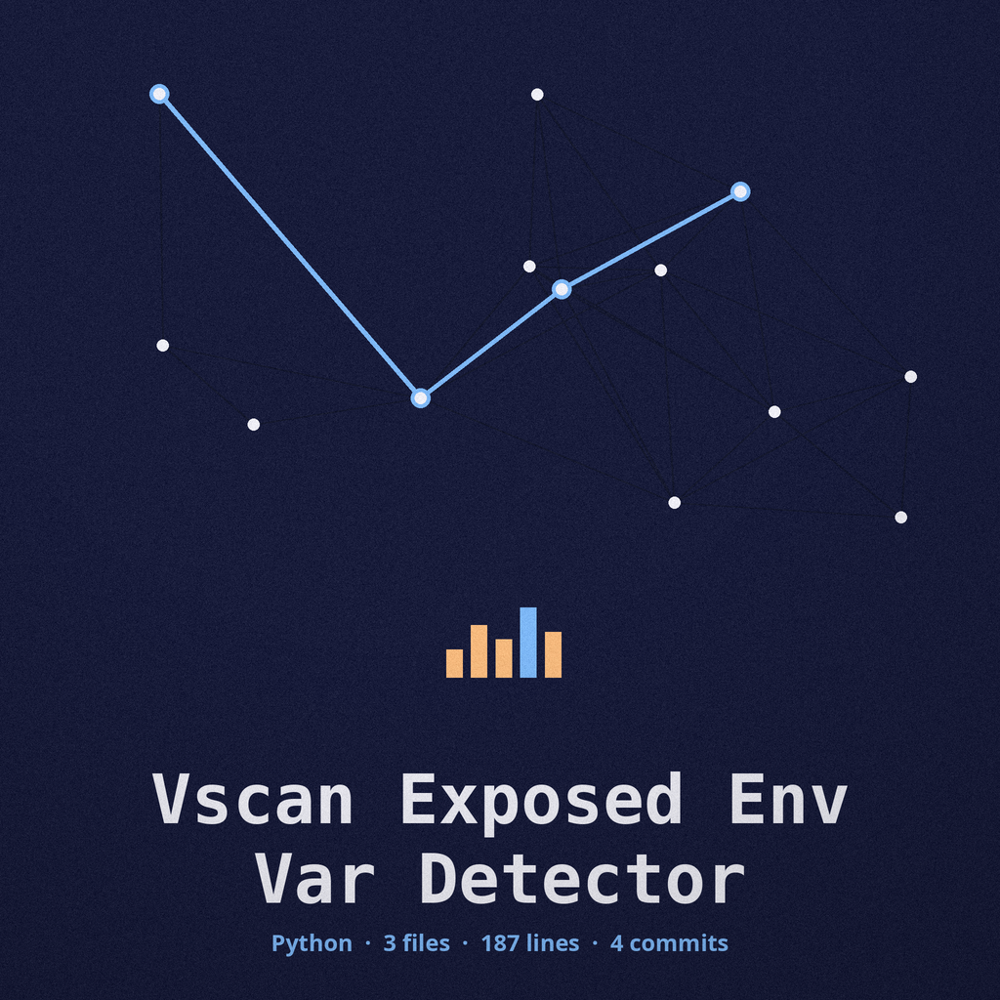
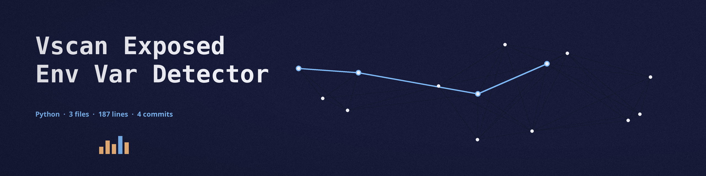

# vscan-exposed-env-var-detector

Fetches the single URL given and scans its response body with regular expressions for common exposed environment variable patterns: API keys, secret keys, passwords, database URLs, AWS keys, and JWT secrets. Matching is case-insensitive, so title case names such as Password or Api_Key are detected as well. It is part of a lightweight web application vulnerability scanning toolkit focused on common misconfigurations.

Only the one named page is fetched: nothing is crawled and no linked script or configuration file is read separately. A response with an HTTP error status is still scanned, because error pages are a common place for these values to leak; only a request that produces no response at all is a failed fetch. Each distinct variable is reported once, however many times it appears in the page.

## Install
`git clone https://github.com/ShadowGuard-AI/vscan-exposed-env-var-detector`

Then install the dependencies: `pip install -r requirements.txt`

## Usage
`python3 main.py <url> [params]`

Example: `python3 main.py http://127.0.0.1:8000/config`

Findings report the pattern kind and the variable name only. Matched values are shown as [MASKED] in the printed results and in the output file, and are never saved in clear. An invalid URL (only http and https are accepted) or a failed fetch prints a failure line and exits with status 1.

## Parameters
- `-h`: Show help message and exit
- `-o`, `--output`: Output file to save results to.
- `-v`, `--verbose`: Enable verbose output (debug logging).

## License
MIT. See LICENSE.
